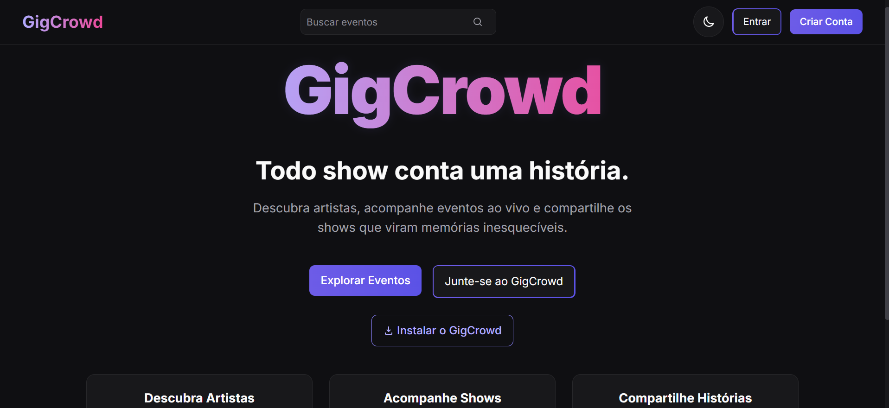
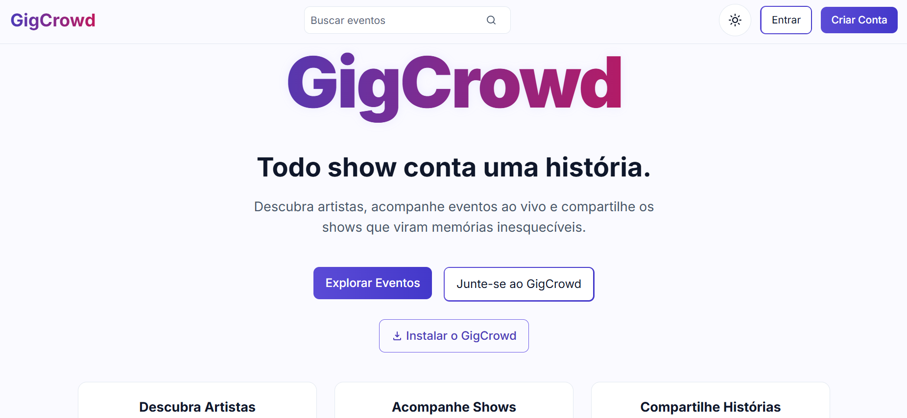
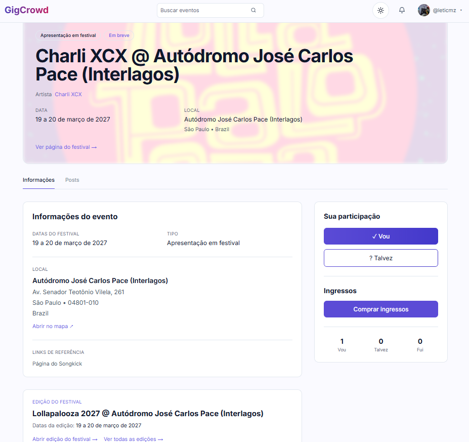
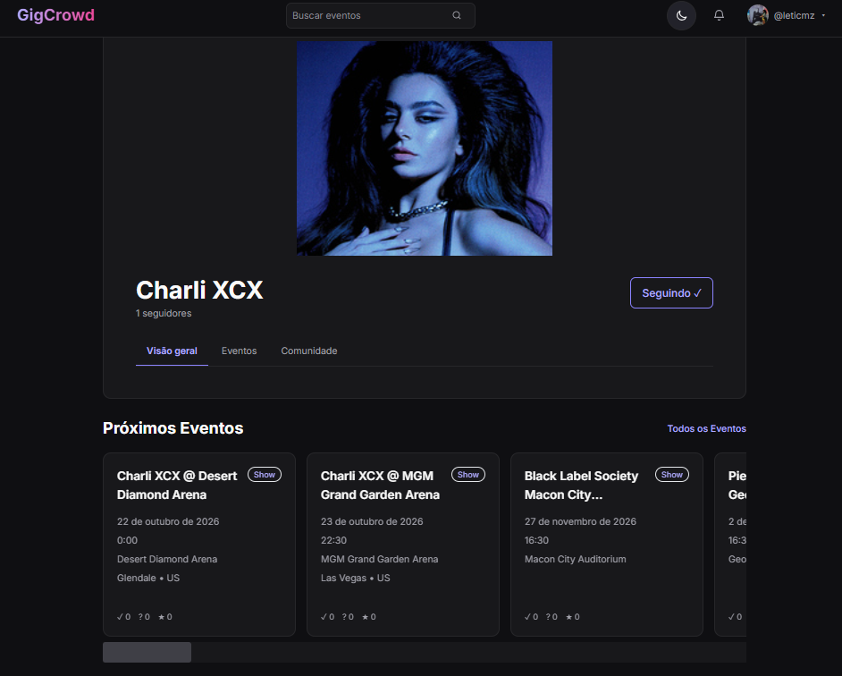
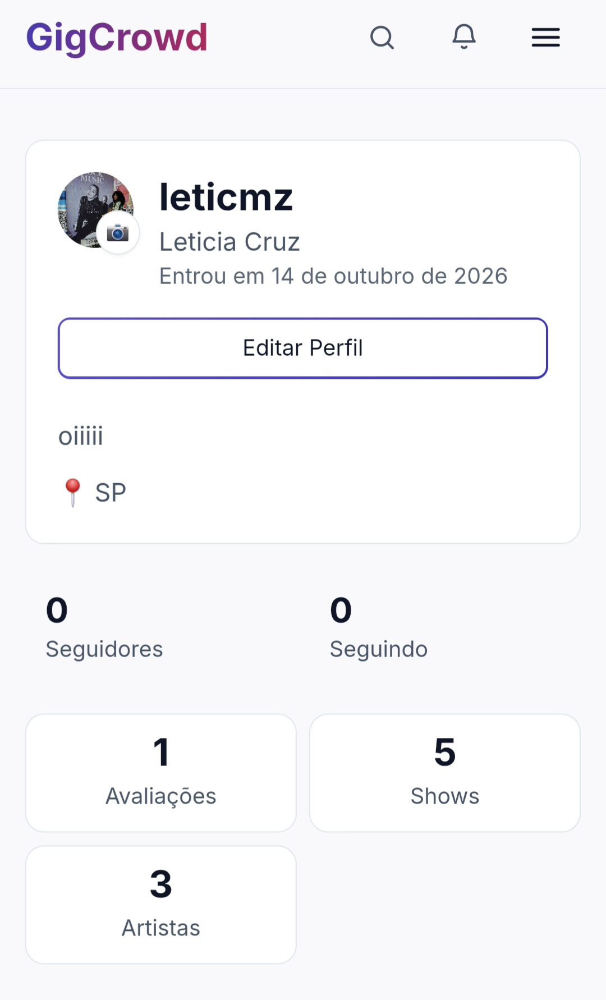
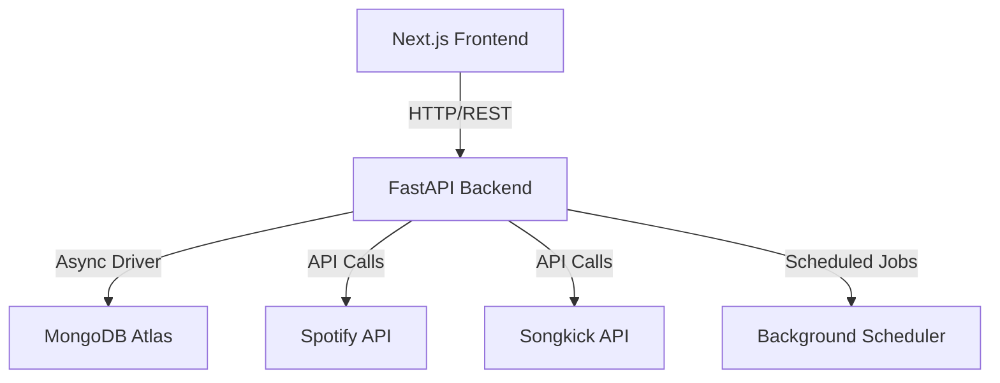

# GigCrowd

Every concert tells a story.

GigCrowd is a social platform for live music enthusiasts, bringing concert discovery, artist tracking, attendance history, and community experiences together in one place.

Inspired by the event discovery experience of Facebook Events and the social cataloging of Letterboxd, GigCrowd helps people discover live music, document their concert journeys, and connect through the experiences that bring us together.

---

## 🌐 Live Demo

- **Application**: [gigcrowd.vercel.app](https://gigcrowd.vercel.app/pt-BR)
- **API Documentation**: [gigcrowd-api.onrender.com/docs](https://gigcrowd-api.onrender.com/docs)
- **API Status**: [gigcrowd-api.onrender.com/health](https://gigcrowd-api.onrender.com/health)

---

## Screenshots

### Home — Dark Mode


### Home — Light Mode


### Festival Events


### Artist Details


### Mobile Experience


---
## 🎯 The Problem

Live music fans often rely on multiple platforms to:

- 🎫 Discover concerts and festivals
- ❤️ Follow their favorite artists
- 📅 Keep track of upcoming events
- 🎟️ Record concerts they've attended
- 📸 Save photos and memories
- 👥 Connect with people who share their musical interests

Most platforms focus on individual parts of this experience. GigCrowd explores how to bring the entire live music journey together.

---

## ✨ Features

### Concert Discovery
Search for artists and explore live events through integrated music and event data providers.

### Artist Discovery and Profiles
Find artists, explore their information, and import artist data into GigCrowd.

### Favorite Artists
Follow artists and build a personalized collection of the musicians you care about.

### Concert History
Build a personal record of live music experiences and keep track of concerts attended.

### Festival Support
Explore festivals with detailed lineup information and edition management.

### Social Community
Connect with other music fans and discover shared interests through social features.

### Multi-Language Support
Available in English, Portuguese (Brazil), and Spanish.

---

## 🛠️ Tech Stack

### Frontend
- **Next.js 14** - React framework with server-side rendering
- **React 18** - UI library
- **TypeScript** - Type-safe development
- **Tailwind CSS** - Utility-first CSS framework
- **next-intl** - Internationalization support (en, pt-BR, es)
- **Axios** - HTTP client for API communication
- **date-fns** - Date manipulation utilities

### Backend
- **Python** - Programming language
- **FastAPI** - Modern, fast web framework for building APIs
- **Pydantic** - Data validation using Python type annotations
- **Motor** - Async MongoDB driver
- **PyMongo** - MongoDB driver
- **python-jose** - JWT token handling
- **passlib** - Password hashing
- **APScheduler** - Background job scheduling
- **Pytest** - Testing framework

### Database
- **MongoDB** - Document-oriented database
- **MongoDB Atlas** - Managed database infrastructure

### External Integrations
- **Spotify API** - Artist discovery and artist image data
- **Songkick** - Artist resolution and concert/event data

### Deployment
- **Vercel** - Frontend hosting
- **Render** - Backend hosting
- **MongoDB Atlas** - Managed database service

### Development Tools
- **Docker** - Containerized development environment
- **Playwright** - Browser automation and testing
- **Git** - Version control

---

## 🏗️ Architecture

GigCrowd uses a frontend/backend architecture with a REST API and a document-oriented database.



### Key Components

**Frontend (Next.js)**
- Multi-language support with next-intl
- Server-side rendering for performance
- Progressive Web App capabilities (Serwist)
- Responsive design with Tailwind CSS

**Backend (FastAPI)**
- RESTful API design
- JWT-based authentication
- Async/await for concurrent operations
- Background job scheduling for data synchronization
- Rate limiting on authentication endpoints
- Security middleware (CORS, CSP, rate limiting)

**Database (MongoDB)**
- Document-oriented storage for flexible schemas
- Async operations with Motor
- Managed infrastructure with MongoDB Atlas

**Integrations**
- Spotify: Artist discovery and metadata enrichment
- Songkick: Event data and artist resolution
- Data synchronization with scheduled background jobs

---

## 📚 API Examples

### Health Check

Check if the API is running:

```bash
curl https://gigcrowd-api.onrender.com/health
```

Response:
```json
{
  "status": "ok",
  "service": "GigCrowd API",
  "scheduler": {
    "enabled": true,
    "running": true,
    "in_progress": false,
    "interval_minutes": 60
  }
}
```

### Search Events

Search for events in the catalogue:

```bash
curl "https://gigcrowd-api.onrender.com/events?limit=20"
```

With text search:
```bash
curl "https://gigcrowd-api.onrender.com/events?q=rock&limit=20"
```

With genre filter:
```bash
curl "https://gigcrowd-api.onrender.com/events?genre=Rock&limit=20"
```

### Search Artists

Search for artists:

```bash
curl "https://gigcrowd-api.onrender.com/artists/search?q=taylor%20swift"
```

### Get Artist Profile

Get an artist's profile:

```bash
curl "https://gigcrowd-api.onrender.com/artists/taylor-swift"
```

### List Available Genres

Get genres available for filtering:

```bash
curl "https://gigcrowd-api.onrender.com/events/genres"
```

### JavaScript Example

Using fetch to search events:

```javascript
const API_BASE = 'https://gigcrowd-api.onrender.com';

async function searchEvents(query, genre = null, limit = 20) {
  const params = new URLSearchParams({
    q: query,
    limit: limit.toString()
  });

  if (genre) {
    params.append('genre', genre);
  }

  const response = await fetch(`${API_BASE}/events?${params}`);
  const data = await response.json();

  return data;
}

// Usage
searchEvents('rock', 'Rock', 10)
  .then(data => console.log(data))
  .catch(error => console.error('Error:', error));
```

### Authentication Example

Login to obtain an access token:

```bash
curl -X POST https://gigcrowd-api.onrender.com/auth/login \
  -H "Content-Type: application/x-www-form-urlencoded" \
  -d "username=your_email@example.com&password=your_password"
```

Response:
```json
{
  "access_token": "eyJhbGciOiJIUzI1NiIsInR5cCI6IkpXVCJ9...",
  "token_type": "bearer",
  "user": {
    "id": "...",
    "email": "your_email@example.com",
    "username": "username"
  }
}
```

Use the token for authenticated requests:

```bash
curl https://gigcrowd-api.onrender.com/users/me \
  -H "Authorization: Bearer YOUR_ACCESS_TOKEN"
```

> For a complete API reference, visit the [Swagger documentation](https://gigcrowd-api.onrender.com/docs).

---

## 🧪 Quality and Testing

### Backend Testing
- Pytest for unit and integration tests
- pytest-asyncio for async test support
- pytest-cov for coverage reporting
- Organized test structure mirroring the application modules

### Test Organization
- Domain layer tests
- Repository tests
- Service layer tests
- Integration tests
- Provider integration tests

---

## 🗺️ Roadmap

### Implemented
- JWT authentication foundation
- User and artist API foundations
- Artist search and import workflow
- Spotify artist discovery integration
- Songkick artist resolution and event data integration
- Follow system for artists
- REST API structure
- Frontend and backend deployment
- Multi-language support (en, pt-BR, es)
- Festival support with lineup management
- Concert attendance tracking
- Background job scheduling for data synchronization

### In Development
- Artist and event experience improvements
- Activity feed and community interactions
- Social posts and media uploads
- Event timeline
- Data enrichment and search improvements

### Planned
- Personalized recommendations
- Expanded notifications
- Further mobile experience improvements
- Additional automation and infrastructure integrations
- Concert wishlist feature

---

## 🔐 Security

- Authentication handled through JWT-based mechanisms
- Secrets and API credentials configured through environment variables
- Production and development environments use separate configuration
- Rate limiting on authentication endpoints
- Security headers middleware (CSP, X-Frame-Options, etc.)
- CORS configuration for controlled cross-origin access
- No sensitive data committed to version control

---

## ❤️ Why GigCrowd?

GigCrowd started with a simple frustration: there was no single place dedicated to the complete concert experience.

Discovering a show, finding other fans, tracking attendance, and remembering the moments that made a concert special are experiences worth connecting.

GigCrowd is a personal project inspired by the relationship between music, live experiences, memories, and community.

The goal is not simply to list concerts, but to build a place where every show can become part of someone's story.

---

## 🔮 Vision

GigCrowd aims to become a home for live music enthusiasts: a place to discover concerts, follow artists, document experiences, preserve memories, and connect with people who love live music.

Because every concert tells a story.

GigCrowd is where those stories live.

---

## 📄 Note on Source Code

This repository presents the GigCrowd project, its documentation, and public examples. The main source code is maintained in a private repository to protect sensitive configurations, credentials, and implementation details.

The materials here are designed to demonstrate the project's architecture, capabilities, and API for evaluation and collaboration purposes.

---

## 👤 Author

Developed by [Leticia Cruz](https://github.com/leticiacmz)

---

## 📄 License

The materials in this repository are presented for demonstration purposes. The licensing terms for the showcase materials and the private source code may differ. For collaboration inquiries, please contact the author.
