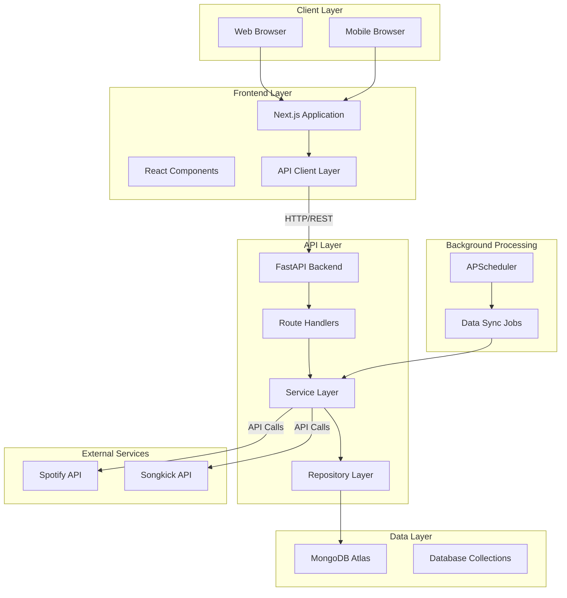
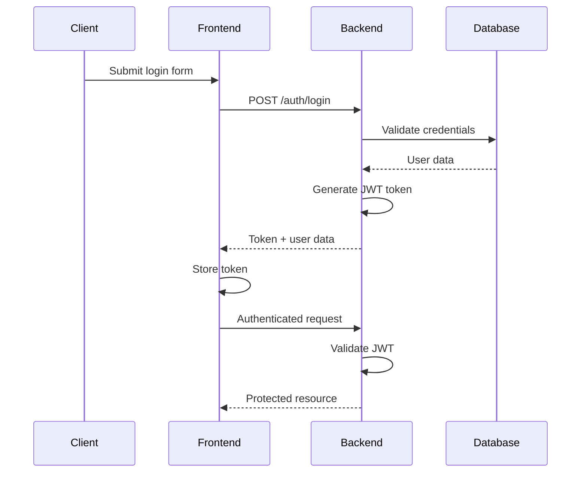

# GigCrowd Architecture

## Overview

GigCrowd follows a classic frontend/backend separation with a REST API architecture. The system is designed to be modular, maintainable, and scalable, with clear separation of concerns across layers.

## System Architecture

## Frontend Architecture

### Technology Stack
- **Framework**: Next.js 14 with App Router
- **Language**: TypeScript
- **Styling**: Tailwind CSS
- **Internationalization**: next-intl
- **State Management**: React hooks and context
- **HTTP Client**: Axios

### Key Components

**Page Structure**
- `app/[locale]/` - Internationalized routes
- `app/[locale]/artists/` - Artist discovery and profiles
- `app/[locale]/events/` - Event browsing and discovery
- `app/[locale]/feed/` - Activity feed
- `app/[locale]/profile/` - User profiles
- `app/[locale]/festivals/` - Festival pages

**Internationalization**
- Supported locales: en, pt-BR, es
- Locale prefix routing (e.g., /pt-BR/events)
- Centralized message files in `messages/` directory
- Server-side locale detection

**Progressive Web App**
- Service worker with Serwist
- Offline capabilities
- Install prompt support

### Data Flow

1. User interacts with React components
2. Components call API client functions
3. API client makes HTTP requests to FastAPI backend
4. Responses are processed and stored in component state
5. UI updates based on state changes

## Backend Architecture

### Technology Stack
- **Framework**: FastAPI
- **Language**: Python
- **Database**: MongoDB with Motor (async driver)
- **Authentication**: JWT with python-jose
- **Scheduling**: APScheduler
- **Testing**: Pytest

### Layered Architecture

**Route Layer** (`app/routes/`)
- HTTP endpoint definitions
- Request validation
- Response formatting
- Authentication dependency injection

Routes organized by domain:
- `artists.py` - Artist-related endpoints
- `events.py` - Event search and retrieval
- `festivals.py` - Festival management
- `users.py` - User profiles and management
- `auth.py` - Authentication endpoints
- `search.py` - Unified search
- `posts.py` - Social posts
- `feed.py` - Activity feed
- `follows.py` - Follow relationships
- `notifications.py` - User notifications
- `media.py` - Media upload handling

**Service Layer** (`app/services/`)
- Business logic implementation
- Coordination between repositories
- External API integration
- Data transformation and enrichment

Key services:
- `ArtistService` - Artist CRUD operations
- `ArtistSearchService` - Artist discovery
- `ArtistImportService` - Artist data import
- `EventService` - Event management
- `EventSearchService` - Event discovery
- `EventImportService` - Event data import
- `FestivalService` - Festival operations
- `UserConcertService` - Concert attendance tracking
- `ActivityService` - Activity feed generation
- `LineupEnrichmentService` - Festival lineup processing
- `SynchronizationService` - Data synchronization

**Repository Layer** (`app/repositories/`)
- Database access abstraction
- Query construction
- Data persistence
- Index management

Repositories:
- `ArtistRepository` - Artist data access
- `EventRepository` - Event data access
- `VenueRepository` - Venue data access
- `UserRepository` - User data access
- `ShowLogRepository` - Concert attendance logs
- `ArtistFollowRepository` - Follow relationships

**Domain Models** (`app/models/`)
- Data structure definitions
- Pydantic models for validation
- Business entities

**Schema Layer** (`app/schemas/`)
- Request/response schemas
- API contract definitions
- Validation rules

**Provider Layer** (`app/providers/`)
- External API abstractions
- Provider registry pattern
- Integrations:
  - Spotify (artist discovery, images)
  - Songkick (events, artist resolution)
  - Bandsintown (alternative event source)

### Database Schema

**Collections**
- `users` - User accounts and profiles
- `artists` - Artist information and metadata
- `events` - Concert and event data
- `venues` - Venue information
- `festivals` - Festival series and editions
- `show_logs` - User concert attendance records
- `artist_follows` - User-artist follow relationships
- `posts` - Social posts and reviews
- `activities` - Activity feed entries
- `notifications` - User notifications

**Key Indexes**
- Artist name and slug
- Event date and venue
- User attendance history
- Follow relationships
- Activity timeline

### Authentication Flow

### Background Jobs

**Scheduler**: APScheduler

**Job Types**:
- Artist synchronization with external providers
- Event data refresh
- Lineup enrichment for festivals
- Activity feed generation

**Configuration**:
- Configurable intervals
- Batch processing limits
- Error handling and retry logic

## External Integrations

### Spotify API
- **Purpose**: Artist discovery, metadata enrichment, image retrieval
- **Usage**:
  - Search for artists by name
  - Fetch artist profiles
  - Get related artists for recommendations
  - Retrieve artist images
- **Rate Limiting**: Respects Spotify API rate limits
- **Data Storage**: Cached in MongoDB to reduce API calls

### Songkick API
- **Purpose**: Event data, artist resolution, venue information
- **Usage**:
  - Search for events by artist
  - Resolve artist identities
  - Fetch event details
  - Get venue information
- **Rate Limiting**: Respects Songkick API rate limits
- **Data Storage**: Cached in MongoDB with refresh strategies

## Security Architecture

### Authentication
- JWT-based stateless authentication
- Token expiration configurable
- Bearer token in Authorization header
- Refresh token mechanism (if implemented)

### Security Middleware
- CORS configuration for controlled cross-origin access
- Content Security Policy (CSP) headers
- X-Frame-Options to prevent clickjacking
- X-Content-Type-Options to prevent MIME sniffing
- Rate limiting on authentication endpoints (100 requests/minute)
- No-cache headers for sensitive responses

### Data Protection
- Environment variables for sensitive configuration
- No credentials in version control
- Separate configurations for development and production
- Password hashing with bcrypt

## Deployment Architecture

### Frontend (Vercel)
- Automatic deployments from Git
- Edge network distribution
- Optimized build process
- Environment variable management

### Backend (Render)
- Container-based deployment
- Auto-scaling capabilities
- Health check endpoint for monitoring
- Environment variable management

### Database (MongoDB Atlas)
- Managed MongoDB service
- Automatic backups
- Global distribution
- Index management

## Performance Considerations

### Frontend
- Server-side rendering for initial page load
- Static generation where applicable
- Image optimization
- Code splitting
- Lazy loading

### Backend
- Async/await for concurrent operations
- Database query optimization with indexes
- Response pagination
- Caching of external API responses
- Background job processing for heavy operations

### Database
- Appropriate indexing for common queries
- Document structure optimization
- Connection pooling
- Read preference configuration

## Scalability Considerations

### Horizontal Scaling
- Stateless API design enables horizontal scaling
- Database sharding capability (MongoDB Atlas)
- CDN for static assets (Vercel)

### Vertical Scaling
- Background job processing can be isolated
- Database read replicas for read-heavy workloads
- Provider API rate limiting protects external services

## Monitoring and Observability

### Health Checks
- `/health` endpoint reports API and scheduler status
- Scheduler status includes job state and next run time

### Logging
- Structured logging with context
- Request/response logging for debugging
- Error tracking for production issues

## Development Workflow

### Local Development
- Docker Compose for local environment
- Separate frontend and backend containers
- MongoDB container for local database
- Hot reload for development

### Testing
- Unit tests for business logic
- Integration tests for API endpoints
- Provider integration tests for external APIs
- E2E tests with Playwright for critical user flows

---

## Future Architectural Considerations

### Potential Improvements
- Message queue (RabbitMQ) for asynchronous processing
- Caching layer (Redis) for frequently accessed data
- Search engine (Elasticsearch) for advanced search capabilities
- Event sourcing for activity tracking
- Microservices decomposition for specific domains
- GraphQL API as an alternative to REST
